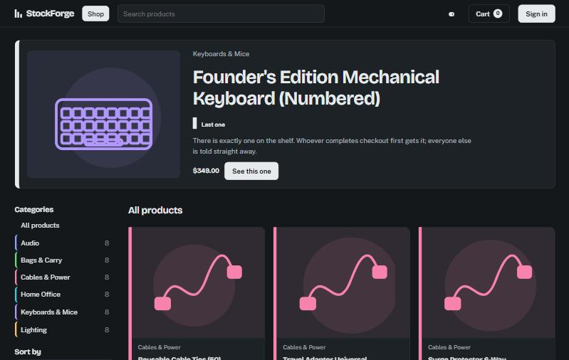
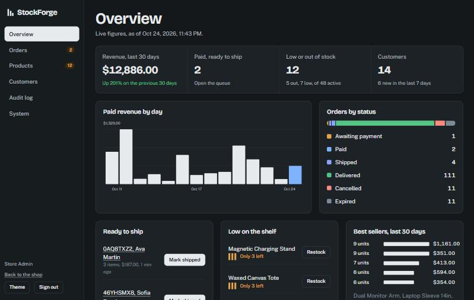
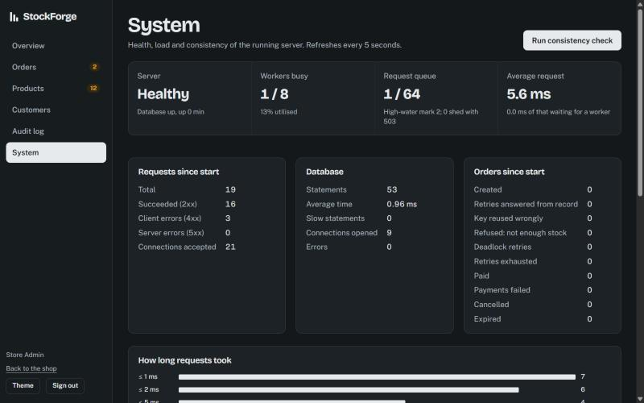
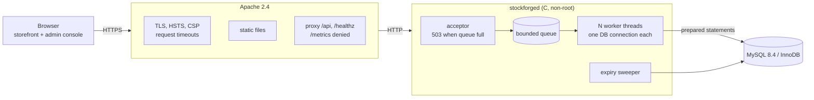
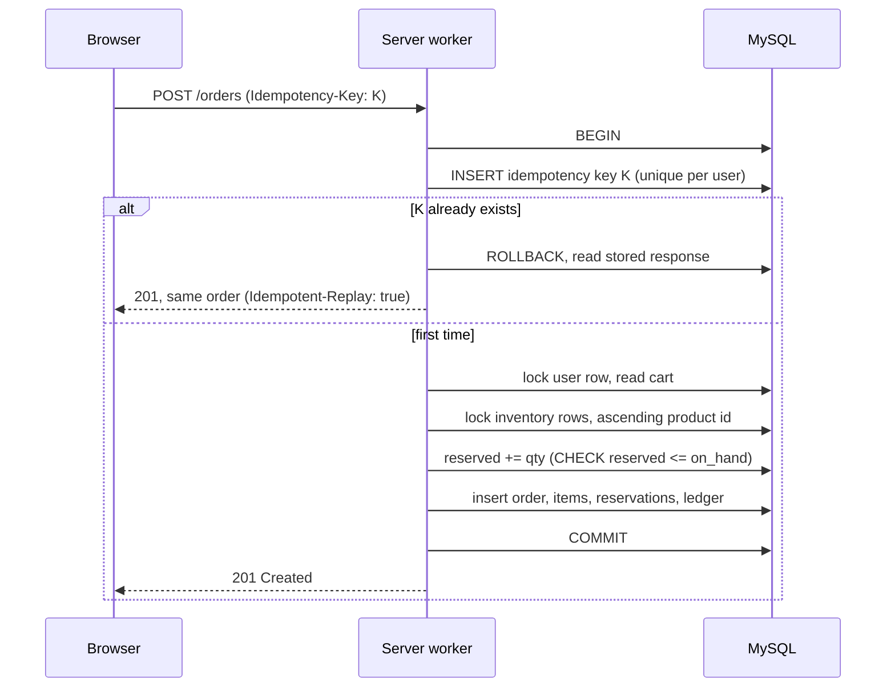
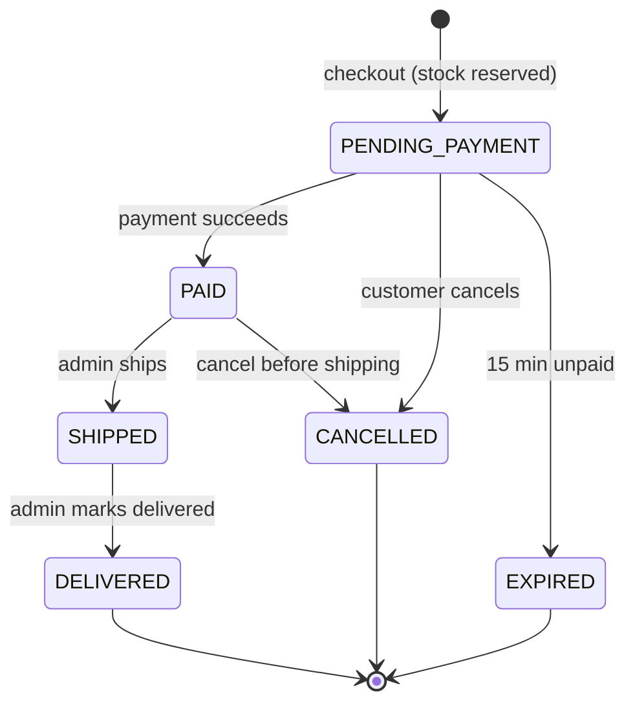
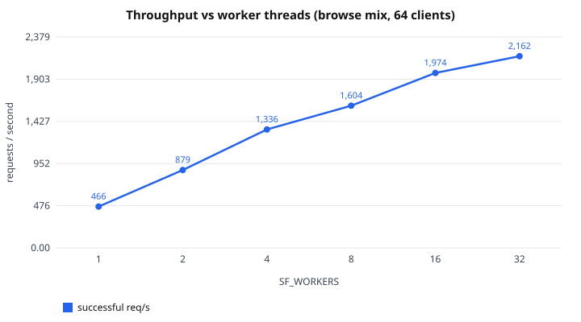
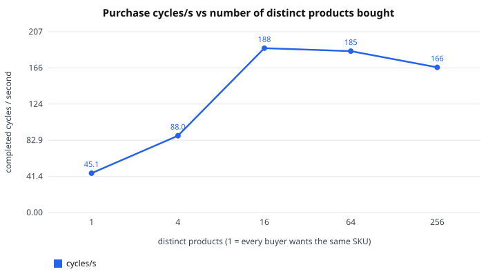

<div align="center">

# StockForge

**An online retail store on Linux systems programming, built around a checkout that cannot oversell.**

C (pthreads, sockets, POSIX) · MySQL 8.4 · Apache 2.4 · HTML/CSS/JS




</div>

---

## What this is

A complete small store: shoppers browse, fill a cart, check out and pay (against a labelled
payment simulator); administrators ship orders, manage stock and customers, and watch the
server's health. The interesting part is underneath: a hand-written C HTTP server with a
thread pool, and a checkout built so that three hundred people racing for the last unit
produce exactly one order, retries never duplicate anything, and a database connection cut
at any point leaves the data consistent.

| | |
|---|---|
| **Concurrency-safe checkout** | one transaction, rows locked in a fixed order, idempotency keys, a database `CHECK` as a backstop |
| **Proven by attack, not by claim** | 300-buyer race, database cut at every statement, 28 deliberately broken versions of the code |
| **Systems programming** | `accept4`, bounded queue, worker pool, self-pipe shutdown, per-request deadlines, load shedding |
| **Secure by default** | Argon2id, hashed session tokens, CSRF + Origin checks, strict CSP, least-privilege DB user |
| **Measured, not guessed** | reproducible benchmarks with ranges over repeated runs, query-plan study, thread sampling |

## Screens

<table>
<tr>
<td width="50%"><br><sub><b>Admin overview.</b> Every figure comes from the database; tests cross-check them with independent SQL.</sub></td>
<td width="50%"><br><sub><b>System page.</b> Live worker, queue and database counters, and a button that runs every consistency invariant.</sub></td>
</tr>
</table>

The stock tally on each product (one notch per unit, and a single marked notch for "Last one") is the
signature element: the number a shopper sees is the number the database enforces.

## Architecture



More detail, including module boundaries and the shutdown sequence: [docs/ARCHITECTURE.md](docs/ARCHITECTURE.md).

## The checkout, in one picture



Fixed lock order means two checkouts can wait for each other but never deadlock; the `CHECK`
constraint means that even a bug in the application code cannot push `reserved` above `on_hand`.
Full design and the test guarding each guarantee: [docs/CHECKOUT.md](docs/CHECKOUT.md).

### Order lifecycle



## How it is tested

| Layer | What it does | Result on the final code |
|---|---|---|
| Unit tests (C) | HTTP parser, queue, rate limiter, validators, state machine | 239 checks, 0 failed |
| Integration tests (Python) | every endpoint, checkout semantics, 300-buyer race, expiry, recovery, admin console, demo data | 186 tests pass |
| Failure injection | a proxy cuts the database connection after every statement of checkout, pay and cancel | all invariants hold after every cut ([details](docs/FAILURE_TESTING.md)) |
| Authorization matrix | every route as anonymous, customer and admin; a meta-test fails if a route is missing | passes |
| Fuzzing | malformed HTTP and JSON, replayable with `FUZZ_SEED` | no crashes, no 5xx from bad input |
| Sanitizers | the whole suite under ASan + UBSan and under TSan | clean |
| Mutation harness | breaks the code one line at a time (drop a lock, skip a check) and demands a test fail | 28 mutants, all behave as expected |
| Consistency checker | 10 invariants run against the live database (CLI and admin button) | every invariant holds |

All counts are from runs on the final code in this repository (Windows 11, Docker Desktop, Ubuntu 24.04 containers).
The GitHub Actions workflow in `.github/workflows/ci.yml` has **not yet run on GitHub**; `scripts/fresh-clone-test.sh`
(clone, configure, build, test, start the Apache stack and probe it) has passed on a clean clone.

## Measured performance

Every number comes from `bench/run_bench.py` (3 runs per case, median and range reported) on one shared laptop, so compare
configurations with each other, not with other systems. Full tables, environment and caveats: [docs/BENCHMARKS.md](docs/BENCHMARKS.md).

<table>
<tr>
<td width="50%"></td>
<td width="50%"></td>
</tr>
<tr>
<td><sub>Read-heavy browse mix, 64 clients: 466 req/s with 1 worker, 1,604 with 8, 2,162 with 32. The server mostly waits on MySQL, so extra workers help only until the database saturates.</sub></td>
<td><sub>Full purchase cycles when every buyer wants the same product (45/s) versus 16 products (188/s). Contention shows up as queueing, with zero deadlock retries and every invariant intact.</sub></td>
</tr>
</table>

## Quick start

You need Docker and Git. Nothing else is installed on the host.

```bash
cp .env.example .env        # then edit: replace every change-me value
docker compose --env-file .env -f deploy/docker-compose.yml up -d --wait          # MySQL
scripts/dev.sh sh scripts/db-init.sh --seed                                       # schema + demo data
scripts/dev.sh sh scripts/gen-dev-cert.sh                                         # self-signed cert (dev only)
docker compose --env-file .env -f deploy/docker-compose.yml --profile stack up -d --build --wait
```

On Windows PowerShell use `.\scripts\dev.ps1` in place of `scripts/dev.sh`.

Open **https://localhost:8443** (accept the certificate warning) and **https://localhost:8443/admin/**.

| Demo account | Password | Role |
|---|---|---|
| `admin@stockforge.test` | `Admin-Demo-2026!` | admin |
| `ava@stockforge.test`, `ben@stockforge.test` | `Customer-Demo-2026!` | customer |

These passwords are public demo data. The numbered keyboard `SF-KB-FOUNDER` has exactly **one** unit: the checkout demo item.
Full install guide, plain-HTTP dev mode and troubleshooting: [docs/INSTALL.md](docs/INSTALL.md).

## Build and test

```bash
scripts/dev.sh make test                     # unit tests (no database needed)
scripts/dev.sh make itest                    # integration, stress, fault-injection, fuzz (~2 min, needs MySQL)
scripts/dev.sh sh scripts/check.sh           # build + unit + integration
SAN=address,undefined scripts/dev.sh sh scripts/check.sh      # ASan + UBSan
scripts/dev.sh python3 tests/mutation/mutate.py               # mutation harness
scripts/dev.sh sh scripts/it.sh test_db_faults                # one module (add env SF_DUMP_LOG=1 for the server log)
```

TSan needs address-space randomisation off and the database network:

```bash
docker run --rm --security-opt seccomp=unconfined --env-file .env --network stockforge_default \
  -v "$PWD":/work -w /work stockforge-dev setarch x86_64 -R sh -c 'SAN=thread sh scripts/check.sh'
```

Benchmarks (about 15 minutes; builds a 100,000-product database):

```bash
scripts/dev.sh python3 bench/run_bench.py
python3 bench/charts.py && python3 bench/report.py     # regenerates docs/BENCHMARKS.md from the JSON results
```

## Documentation

| Document | What it covers |
|---|---|
| [CHECKOUT.md](docs/CHECKOUT.md) | the checkout design, lock order, and the test guarding each guarantee |
| [FAILURE_TESTING.md](docs/FAILURE_TESTING.md) | what was broken on purpose, and what it found |
| [SECURITY.md](docs/SECURITY.md) | threat model, controls with the test proving each, residual risks |
| [BENCHMARKS.md](docs/BENCHMARKS.md) | measured results, query plans, what the study does not show |
| [API.md](docs/API.md) | every endpoint with real request and response examples |
| [ARCHITECTURE.md](docs/ARCHITECTURE.md) | components, modules, shutdown, invariants |
| [OPERATIONS.md](docs/OPERATIONS.md) | health, metrics, logs, every configuration variable |
| [INSTALL.md](docs/INSTALL.md) | installation, Apache/TLS, troubleshooting |
| [DEMO.md](docs/DEMO.md) | a 12-minute demo script and an 8-slide outline |
| [PLAN.md](docs/PLAN.md), [PHASE4_NOTES.md](docs/PHASE4_NOTES.md), [DB_QUERY_PLANS.md](docs/DB_QUERY_PLANS.md) | plan and design notes |

## Honest limits

* The payment provider is a **simulation**; how its outcomes are handled (declines, timeouts, retries, exactly one success) is real and tested.
* Single node. Rate limits are per process. The server answers `Connection: close` (no keep-alive); that is measured as a cost, not hidden.
* TLS uses a self-signed development certificate; there is no MFA for admins.
* Benchmarks ran on one shared laptop with the load generator, server and database competing for CPUs.
* No licence file yet: until one is added, the code is "all rights reserved" by default.

The full list, with the reasoning, is in [SECURITY.md](docs/SECURITY.md) (section 3) and [BENCHMARKS.md](docs/BENCHMARKS.md) ("What this study does not show").

## Repository layout

```
src/        C server: http, router, handlers, checkout engine, state machine, reconcile, sweeper
web/        storefront and admin console (plain JS modules, no framework, no innerHTML)
deploy/     Dockerfiles, Compose, Apache configuration
db/         schema, migrations, demo seed and 45-day order history generator
tests/      unit (C), integration (Python), mutation harness
tools/      load generator, reconcile CLI, password hasher
bench/      benchmark driver, query-plan study, GDB sampler, charts
scripts/    dev container wrapper, db-init, demo reset, fresh-clone test
docs/       design, security, operations, API, benchmarks
```
