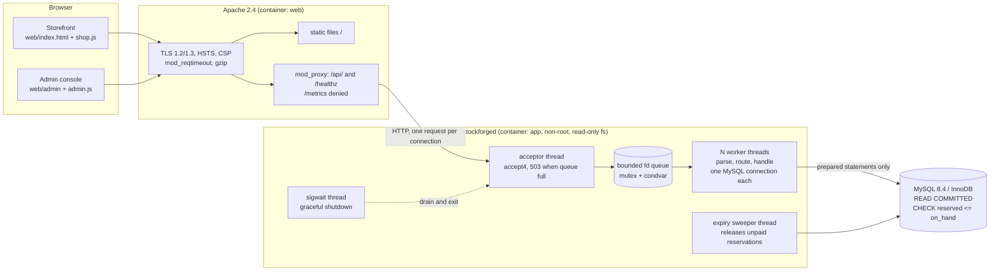

# StockForge — Architecture

## 0. The system on one page



How a checkout travels: browser `POST /api/v1/orders` with an `Idempotency-Key` → Apache → acceptor
queues the socket → a worker parses and routes it → **one transaction** (idempotency row, user row,
cart, inventory rows locked in ascending id, reservations written) → JSON `201`. If the database is
cut at any point, the transaction rolls back and a retry with the same key finds either nothing or the
finished order, never half of one ([CHECKOUT.md](CHECKOUT.md), [FAILURE_TESTING.md](FAILURE_TESTING.md)).

## 1. Topology (detail)

```
Browser ──HTTPS──▶ Apache 2.4 (TLS, static /, gzip, proxy /api)
                      │ HTTP/1.1, one request per connection (loopback)
                      ▼
              ┌─────────────── stockforged (C) ────────────────┐
              │ acceptor thread                                │
              │   accept4() ─▶ bounded queue (cap Q)           │
              │                 mutex + not_empty (push never blocks)│
              │                        │                       │
              │        ┌───────────────┼────────────┐          │
              │     worker 1  …  worker N  (pthreads)          │
              │   each: own MYSQL* conn, parse → route →       │
              │         handler → JSON response                │
              │ signal thread: SIGTERM/INT ⇒ drain & exit      │
              │ metrics: atomics (qdepth, busy, req, errors)   │
              └───────────────────────┬────────────────────────┘
                                      ▼
                              MySQL 8.4 (InnoDB)
```

Overload: queue full ⇒ acceptor writes `503` + `Retry-After: 1` itself and closes. Never blocks, never unbounded memory.

### Server-core design notes (implemented in Phase 3)

- **Why no `not_full` condvar:** the acceptor must never stall, or `accept()` backlog grows invisibly. Full queue ⇒ `503` immediately. Backpressure is explicit and measurable (`connections_rejected_overload`).
- **Lost-wakeup safety:** `fdq_pop` waits in a `while (len == 0 && !closed)` loop; `fdq_close` uses `pthread_cond_broadcast` so every idle worker observes shutdown. Tested with 6 blocked poppers.
- **Shutdown:** signals are blocked in all threads; one `sigwait()` thread writes to a self-pipe, so nothing runs in async-signal context. Sequence: wake acceptor → close listen fd → close queue → workers drain accepted work → join → exit 0.
- **Request deadline:** one monotonic deadline for the *whole* request (not per `recv`), so a slowloris client cannot reset the timer by trickling bytes. Over-deadline ⇒ `408`.
- **Request-smuggling hygiene:** duplicate/malformed/signed `Content-Length` ⇒ `400`; any `Transfer-Encoding` ⇒ `501`. Apache normalises requests upstream, this is defence in depth.
- **Lingering close:** closing a socket with unread bytes makes Linux send RST, which can erase the client's copy of our error response. Error paths therefore `shutdown(SHUT_WR)` then drain (≤200 ms, ≤1 MiB) in workers; the acceptor's 503 path drains non-blocking only. *Found by a failing test, not by inspection.*
- **Known limitation:** `Connection: close` on every response (no keep-alive yet). Apache↔backend connection reuse is a Phase 6 optimisation and will be measured, not assumed.
- **Known limitation:** the acceptor's overload drain is best-effort; a client whose request bytes arrive after the 503 is sent may see a reset instead of the 503.

## 2. Module boundaries (`src/`)

| Module | Responsibility | Depends on |
|---|---|---|
| `main.c`, `config.c` | env-var config, startup, signal thread, graceful shutdown | all |
| `server.c`, `queue.c`, `pool.c` | accept loop, bounded queue, worker lifecycle, timeouts | `http`, `log` |
| `http.c` (+ vendored `picohttpparser`) | parse, size limits, response building, request ids | — |
| `router.c` | method+path → handler, auth/role/CSRF gates | `auth`, handlers |
| `auth.c` | Argon2id, session create/lookup, CSRF, role check, login rate limit | `db` |
| `db.c` | per-worker connection, reconnect, prepared-stmt helpers, tx begin/commit/rollback + deadlock retry | libmariadb |
| `catalog.c` | products/categories list, search, keyset pagination, admin CRUD | `db` |
| `cart.c` | cart CRUD | `db` |
| `inventory.c` | reserve / commit / release primitives (always inside caller's tx) | `db` |
| `orders.c`, `order_state.c` | checkout, cancel, pay, admin transitions; table-driven state machine | `inventory`, `db` |
| `payment_sim.c` | deterministic simulated provider | — |
| `audit.c`, `metrics.c`, `log.c` | audit rows, counters/histograms, JSON logs | — |
| `tools/reconcile.c` | CLI invariant checker (also callable via admin API) | `db` |

Ownership rules: the acceptor owns a connection fd until it is enqueued; the worker that dequeues it owns and closes it. Request-scoped memory lives in a per-request arena freed at end of request. Each worker owns exactly one `MYSQL*`; nothing DB-related is shared between threads. Shared mutable state is limited to the queue (mutex) and metrics (atomics).

## 3. Order state machine

```
              pay ok                ship              deliver
PENDING_PAYMENT ──────▶ PAID ───────────▶ SHIPPED ───────────▶ DELIVERED
   │  │                  │
   │  └─ ttl elapsed ─▶ EXPIRED        (stock released)
   └──── cancel ──────▶ CANCELLED ◀─── cancel (PAID only; stock restored)
```

Legal set (everything else ⇒ `409 ILLEGAL_TRANSITION`): `PENDING_PAYMENT→{PAID,CANCELLED,EXPIRED}`, `PAID→{SHIPPED,CANCELLED}`, `SHIPPED→{DELIVERED}`. `CANCELLED`, `EXPIRED`, `DELIVERED` are terminal. Transitions are compare-and-set: `UPDATE orders SET status=?,version=version+1 WHERE id=? AND status=? AND version=?`; 0 rows ⇒ someone else won ⇒ re-read and return the now-current state (idempotent for repeats of the same transition).

Reservation effects: create ⇒ `reserved += q` (held). pay ⇒ `on_hand -= q, reserved -= q` (committed). cancel/expire from PENDING ⇒ `reserved -= q` (released). cancel from PAID ⇒ `on_hand += q` (ledger reason `restock`-style reversal).

## 4. Checkout transaction (the centerpiece)

`POST /api/v1/orders` with header `Idempotency-Key`:

1. `BEGIN` (READ COMMITTED).
2. `INSERT idempotency_keys (user, key, request_hash)`.
   - Duplicate-key error ⇒ `ROLLBACK`, read existing row. Same `request_hash` and `order_id` set ⇒ replay stored response (`200`, `Idempotent-Replay: true`). Different hash ⇒ `422`. Row exists but no order yet (another tx in flight) ⇒ that tx holds the row lock, so our read blocks until it commits; then replay.
3. Read cart items; `SELECT … FROM inventory WHERE product_id IN (…) ORDER BY product_id FOR UPDATE` — **sorted lock order prevents deadlocks between carts**.
4. If any `on_hand - reserved < qty` ⇒ `ROLLBACK`, `409 INSUFFICIENT_STOCK` listing offending SKUs (idempotency row rolled back too, so the client may retry with the same key after restocking).
5. `UPDATE inventory SET reserved = reserved + ?` per line; insert `orders`, `order_items` (price snapshot), `stock_reservations`, `inventory_ledger`, `audit_events`; clear cart; store response in idempotency row.
6. `COMMIT`. Deadlock (1213) / lock-wait-timeout (1205) ⇒ rollback and retry up to 3× with jittered backoff; then `503`.

Why not application mutexes: they do not span processes. The row lock + `CHECK (reserved <= on_hand)` + `UNIQUE (user_id, idem_key)` hold regardless of how many server processes or threads race.

## 5. Invariants and where each is enforced

| # | Invariant | SQL enforcement | App enforcement | Test (phase) |
|---|---|---|---|---|
| I1 | `on_hand ≥ 0`, `reserved ≥ 0` | `UNSIGNED` columns | checked before update | stress (5) |
| I2 | `reserved ≤ on_hand` (no overselling) | `ck_inventory_reserved_le_onhand` ✅ verified | `FOR UPDATE` + availability check | stress (5) |
| I3 | `reserved == Σ held reservation qty` per product | — (cross-table) | same-tx maintenance | reconcile (5) |
| I4 | `on_hand == seed + Σ ledger.delta_on_hand` | append-only ledger | written in same tx | reconcile (5) |
| I5 | One order per `(user, idempotency key)` | `uq_idem` | replay logic | duplicate-delivery (5) |
| I6 | One reservation per (order, product) | `uq_res_order_product` | — | integration (4) |
| I7 | Legal state transitions only | ENUM domain | `order_state.c` + CAS | unit + integration (4) |
| I8 | Failed tx leaves no partial deduction | InnoDB atomicity | single tx boundary | fault injection (6) |
| I9 | Order total == Σ item price × qty | — | computed from snapshot in tx | reconcile (5) |
| I10 | Every PENDING order past `expires_at` is eventually released | `ix_orders_pending_expiry` | expiry sweep | restart test (6/8) |

MySQL, not this project, owns WAL/redo logging and crash recovery. We test *application-level* recovery: kill the server or DB mid-checkout, restart, run reconcile, assert I1–I10.

## 6. API surface (v1, JSON, `/api/v1`)

| Method & path | Auth | Notes |
|---|---|---|
| `GET /healthz`, `GET /metrics` | none / admin | liveness+DB ping; counters |
| `POST /auth/register`, `/auth/login`, `/auth/logout` | – | login rate-limited; cookie `sf_sid` (HttpOnly, Secure, SameSite=Lax) |
| `GET /products?q&category&sort&after&limit` | – | keyset pagination, `limit ≤ 50` |
| `GET /products/{id}`, `GET /categories` | – | includes `available` |
| `GET/PUT/DELETE /cart…` | customer | CSRF header `X-CSRF-Token` on writes |
| `POST /orders` | customer | `Idempotency-Key` required |
| `GET /orders`, `GET /orders/{public_id}` | customer | own orders only |
| `POST /orders/{id}/pay` | customer | simulated provider; scenario selectable in dev |
| `POST /orders/{id}/cancel` | customer/admin | idempotent |
| `GET /admin/orders`, `POST /admin/orders/{id}/transition` | admin | filters, CAS |
| `GET/POST/PATCH /admin/products`, `/admin/inventory/{id}/adjust` | admin | writes ledger+audit |
| `GET /admin/audit`, `/admin/stats`, `/admin/reconcile`, `/admin/users` | admin | |

Error envelope: `{"error":{"code":"INSUFFICIENT_STOCK","message":"…","request_id":"…"}}`; codes are stable strings, never stack traces or SQL text.

### 6a. Implementation status (end of Phase 4)

| Status | Endpoints |
|---|---|
| ✅ Implemented + tested | `GET /healthz` (readiness: pings MySQL, 503 if down), `GET /metrics` (bearer token or admin session), `POST /auth/register`, `/auth/login`, `/auth/logout`, `GET /auth/me`, `GET /categories`, `GET /products` (q, category, sort, after, limit), `GET /products/{id}`, `GET/DELETE /cart`, `PUT/DELETE /cart/items/{id}`, `GET /orders`, `GET /orders/{public_id}`, `POST /admin/products`, `POST /admin/inventory/{id}/adjust`, `GET /admin/audit` |
| ✅ Implemented + tested (Phase 5) | `POST /orders` (checkout, `Idempotency-Key`), `POST /orders/{id}/pay`, `POST /orders/{id}/cancel`, `GET /admin/reconcile`, background reservation expiry. Design: [CHECKOUT.md](CHECKOUT.md) |
| ⏳ Phase 7 | `GET /admin/orders`, order transitions, `PATCH /admin/products`, `GET /admin/users`, `GET /admin/stats`, `GET /admin/reconcile` |

## 7. Security model (summary; full threat model in Phase 7)

*(Details of what is actually implemented are in section 8.)* Argon2id via libsodium; 256-bit random session tokens, only SHA-256 stored; cookie flags HttpOnly/Secure/SameSite; double-submit-style CSRF token bound to session; prepared statements only; JSON escaping on output and `textContent`-only DOM insertion on the frontend; per-IP + per-account login throttling; 64 KiB body / 8 KiB header caps; read/write socket timeouts; secrets only from env; logs never contain passwords, tokens or card data; payments are simulated and no PAN field exists.
