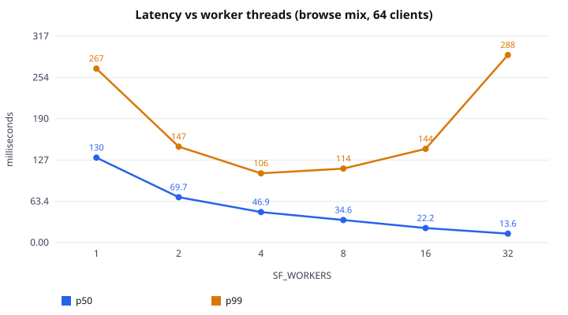
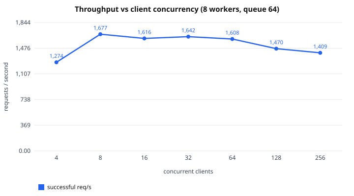
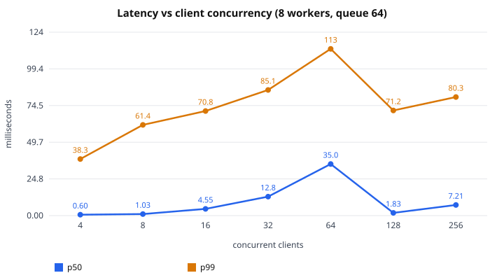
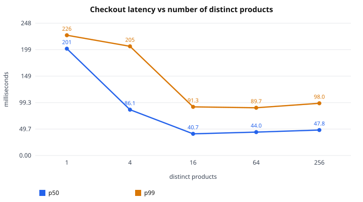
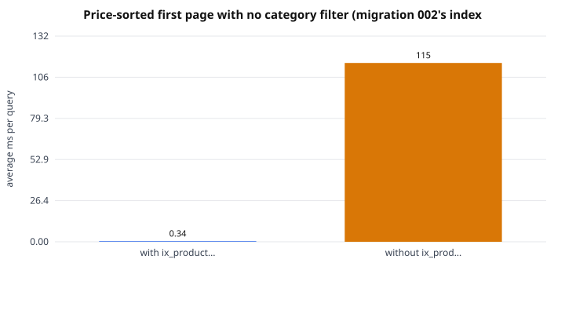
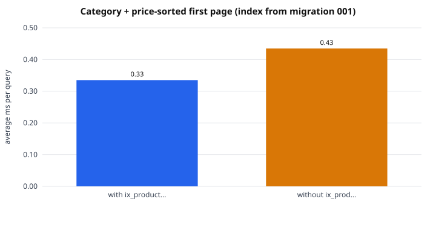
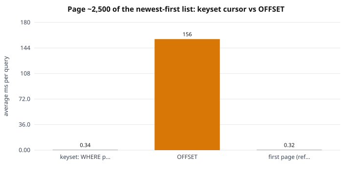
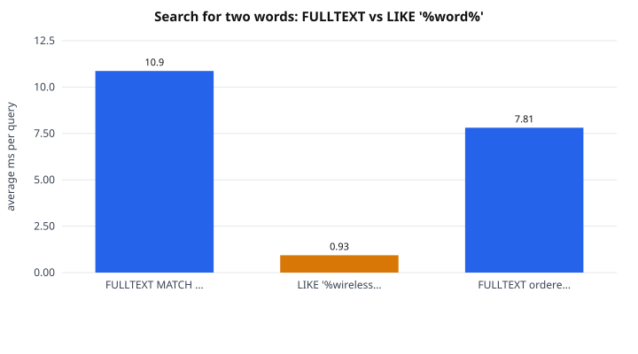
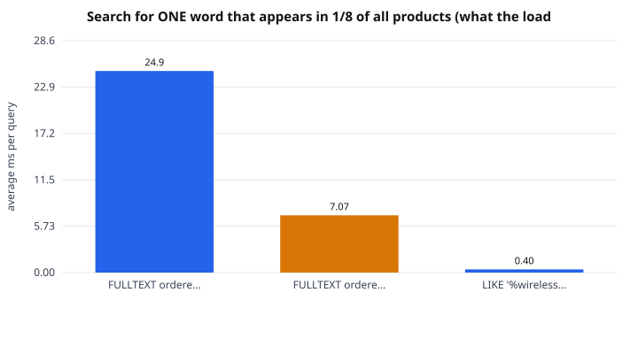
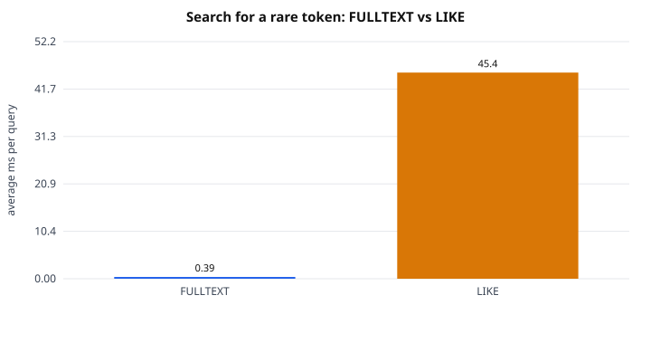

# Benchmarks (measured)

Every number below was produced by `bench/run_bench.py` and read from `bench/results/*.json` by `bench/report.py`; nothing is estimated. Treat them as **this laptop**: a shared machine where the generator, server and database compete for CPUs. each case run 3x with a fresh server; the median run is reported and the min-max range shown. The *range over runs* columns show how much the same case varied between runs (in an earlier run of the same configuration the hot-SKU case differed by about 25%), so only differences larger than that range mean anything. Compare configurations against each other, not against other systems.

## Environment

| item | value |
|---|---|
| CPU | 13th Gen Intel(R) Core(TM) i7-13650HX (20 logical CPUs) |
| Memory | 11.5 GB |
| OS / kernel | Ubuntu 24.04.5 LTS / 6.18.33.2-microsoft-standard-WSL2 |
| Where it ran | Docker Desktop (WSL2) on Windows 11; app, load generator and MySQL share this machine |
| Compiler | gcc (Ubuntu 13.3.0-6ubuntu2~24.04.1) 13.3.0 |
| MySQL | 8.4.11, InnoDB buffer pool 1024 MiB, `innodb_flush_log_at_trx_commit=1` (full durability, not relaxed) |
| Dataset | 100,048 products, 6 categories, 1,000,000 units per bench product |
| Per case | 2 s warm-up (discarded) + 8 s measured |
| Load generator | closed-loop, one connection per request (server uses Connection: close) |

The load generator, server and MySQL all share the same CPUs, so server throughput is understated by the generator's own CPU use. Each request opens a new TCP connection (the server answers `Connection: close`), so the figures include connection setup.

## 1. Worker-pool size (read-heavy browse mix, 64 client threads)

`SF_WORKERS=1` is the single-threaded baseline: the same code with one worker thread (there is no separate non-threaded build).

| workers | successful req/s (median run) | range over runs | p50 ms | p95 ms | p99 ms | server CPU (cores) | RSS MB | conn fail / timeouts / other 5xx | DB ms per request |
|---|---|---|---|---|---|---|---|---|---|
| 1 | 466 | 449-481 | 130.48 | 234.16 | 267.32 | 0.08 | 7.1 | 0/0/0 | 2.13 |
| 2 | 879 | 787-896 | 69.69 | 121.16 | 147.38 | 0.15 | 7.6 | 0/0/0 | 2.25 |
| 4 | 1,336 | 1,304-1,345 | 46.88 | 85.89 | 106.31 | 0.28 | 8.0 | 0/0/0 | 2.86 |
| 8 | 1,604 | 1,603-1,658 | 34.65 | 84.11 | 113.67 | 0.61 | 8.7 | 0/0/0 | 4.68 |
| 16 | 1,974 | 1,958-1,976 | 22.21 | 118.19 | 143.99 | 0.77 | 10.6 | 0/0/0 | 7.84 |
| 32 | 2,162 | 2,075-2,225 | 13.62 | 154.66 | 288.19 | 0.62 | 13.8 | 0/0/0 | 14.57 |




Per-operation latency in the 8-worker run (this is what shows which request type costs the most):

| operation | requests | p50 ms | p95 ms | p99 ms |
|---|---|---|---|---|
| list_newest | 5081 | 32.88 | 64.48 | 80.57 |
| list_category | 1935 | 33.43 | 63.95 | 82.24 |
| search_common_word | 910 | 90.24 | 126.31 | 150.26 |
| search_rare_token | 1018 | 31.29 | 64.38 | 90.52 |
| detail | 2598 | 32.50 | 63.72 | 79.40 |
| list_price_sorted | 1293 | 32.60 | 65.05 | 78.01 |

## 2. Client concurrency (browse mix, 8 workers, queue capacity 64)

`successful req/s` counts only 2xx responses. Requests shed with an instant `503` (queue full) are shown separately and are NOT throughput. Latency percentiles below include those fast rejections, so read them together with the rejected column.

| clients | successful req/s (median run) | range over runs | 503 shed/s | p50 ms | p99 ms | max ms | queue high-water | rejected by overload (503) | conn fail / timeouts / other 5xx |
|---|---|---|---|---|---|---|---|---|---|
| 4 | 1,274 | 1,174-1,323 | 0 | 0.60 | 38.29 | 46.5 | 3 | 0 | 0/0/0 |
| 8 | 1,677 | 1,624-1,728 | 0 | 1.03 | 61.44 | 75.1 | 5 | 0 | 0/0/0 |
| 16 | 1,616 | 1,593-1,651 | 0 | 4.55 | 70.82 | 95.8 | 9 | 0 | 0/0/0 |
| 32 | 1,642 | 1,525-1,683 | 0 | 12.83 | 85.06 | 138.2 | 25 | 0 | 0/0/0 |
| 64 | 1,608 | 1,599-1,683 | 0 | 34.95 | 112.90 | 139.0 | 57 | 0 | 0/0/0 |
| 128 | 1,470 | 1,466-1,486 | 26,981 | 1.83 | 71.22 | 167.1 | 64 | 269377 | 0/0/0 |
| 256 | 1,409 | 1,396-1,425 | 23,674 | 7.21 | 80.29 | 206.9 | 64 | 241223 | 0/0/0 |




## 3. Hot-row contention: purchase cycles (add to cart, checkout, pay, cancel), 32 buyers, 16 workers

Each cycle is four requests. Buyers pick a product at random from the first K products; K = 1 means every buyer wants the same SKU, so every checkout serialises on one `inventory` row. Stock is never exhausted (1,000,000 units), so this measures lock hand-off, not sell-out. **all database invariants held after the run**.

| distinct SKUs | cycles/s (median run) | cycles/s range over runs | checkout p50 ms | checkout p99 ms | InnoDB row-lock waits | avg lock wait ms | deadlock retries | server CPU (cores) |
|---|---|---|---|---|---|---|---|---|
| 1 | 45.1 | 44-46 | 200.5 | 225.7 | 1439 | 104.9 | 0 | 0.13 |
| 4 | 88.0 | 87-90 | 86.1 | 205.0 | 2306 | 49.4 | 0 | 0.27 |
| 16 | 188.4 | 184-191 | 40.7 | 91.3 | 2638 | 16.7 | 0 | 0.76 |
| 64 | 185.0 | 151-240 | 44.0 | 89.7 | 745 | 12.4 | 0 | 0.81 |
| 256 | 166.4 | 166-167 | 47.8 | 98.0 | 120 | 11.7 | 0 | 0.73 |




## 4. Mixed workload (80% browse, 20% purchase cycles; 64 clients, 16 workers)

| operation | count | p50 ms | p95 ms | p99 ms |
|---|---|---|---|---|
| list_newest | 1802 | 42.06 | 61.34 | 79.82 |
| list_category | 699 | 42.97 | 61.45 | 93.40 |
| search_common_word | 311 | 78.82 | 94.64 | 108.09 |
| search_rare_token | 374 | 41.88 | 57.99 | 69.75 |
| detail | 900 | 42.51 | 62.36 | 82.75 |
| list_price_sorted | 430 | 41.72 | 61.20 | 78.09 |
| cart_put | 1166 | 64.14 | 84.44 | 125.82 |
| checkout | 1174 | 64.08 | 87.99 | 117.56 |
| pay | 1182 | 63.83 | 87.57 | 121.94 |
| cancel | 1196 | 63.45 | 85.86 | 125.88 |

Total 1,154 req/s; purchase cycles completed: 1166 of 1166.

## 5. Where the server's threads spend their time (GDB sampling, buy, 1 hot SKU(s))

20 stack samples of all threads while 32 clients ran against 16 workers. Each sample pauses the process, so use the proportions, not absolute throughput.

| thread state | share of observations |
|---|---|
| waiting on MySQL (network round trip) | 83.9% |
| signal thread | 5.3% |
| sweeper (sleeping between sweeps) | 5.3% |
| acceptor | 5.3% |
| other (top frame: __libc_send) | 0.3% |

## 6. Query plans on 100,048 products (100 executions per variant after warm-up)

Index A/B uses MySQL 8 *invisible indexes*: identical data and statement, the optimizer just cannot see the index. Full `EXPLAIN ANALYZE` text is in [DB_QUERY_PLANS.md](DB_QUERY_PLANS.md).

**Price-sorted first page with no category filter (migration 002's index)**

| variant | avg ms | p50 ms | p99 ms | vs first row |
|---|---|---|---|---|
| with ix_products_active_price | 0.337 | 0.317 | 0.491 | 1.0x |
| without ix_products_active_price (invisible) | 114.931 | 114.237 | 125.593 | 341.0x |



**Category + price-sorted first page (index from migration 001)**

| variant | avg ms | p50 ms | p99 ms | vs first row |
|---|---|---|---|---|
| with ix_products_cat_price | 0.333 | 0.307 | 0.618 | 1.0x |
| without ix_products_cat_price (invisible) | 0.432 | 0.404 | 0.683 | 1.3x |



**Page ~2,500 of the newest-first list: keyset cursor vs OFFSET**

| variant | avg ms | p50 ms | p99 ms | vs first row |
|---|---|---|---|---|
| keyset: WHERE p.id < cursor | 0.339 | 0.308 | 0.601 | 1.0x |
| OFFSET | 156.436 | 155.455 | 172.325 | 461.5x |
| first page (reference) | 0.320 | 0.288 | 0.630 | 0.9x |



**Search for two words: FULLTEXT vs LIKE '%word%'**

| variant | avg ms | p50 ms | p99 ms | vs first row |
|---|---|---|---|---|
| FULLTEXT MATCH ... IN BOOLEAN MODE | 10.870 | 10.859 | 12.713 | 1.0x |
| LIKE '%wireless%' AND LIKE '%keyboard%' | 0.934 | 0.911 | 1.251 | 0.1x |
| FULLTEXT ordered by relevance, not id (no keyset) | 7.812 | 7.726 | 8.928 | 0.7x |



**Search for ONE word that appears in 1/8 of all products (what the load generator's 'common word' does)**

| variant | avg ms | p50 ms | p99 ms | vs first row |
|---|---|---|---|---|
| FULLTEXT ordered by id (what the API does) | 24.898 | 24.790 | 28.598 | 1.0x |
| FULLTEXT ordered by relevance | 7.072 | 6.950 | 8.162 | 0.3x |
| LIKE '%wireless%' | 0.395 | 0.365 | 0.598 | 0.0x |



**Search for a rare token: FULLTEXT vs LIKE**

| variant | avg ms | p50 ms | p99 ms | vs first row |
|---|---|---|---|---|
| FULLTEXT | 0.391 | 0.342 | 0.878 | 1.0x |
| LIKE | 45.350 | 45.072 | 51.143 | 116.0x |



---

## What the measurements say

Everything here is read from the tables above; "derived" marks arithmetic on those numbers rather than a separate measurement.

**1. The server is waiting on the database, not computing.** Server CPU stayed under 0.8 cores in every run of the worker sweep (up to 1.4 cores in the purchase runs), and GDB sampling of 16 workers under the single-hot-SKU purchase load found them inside a MySQL call in 319 of 320 observations and idle in none. So worker threads buy throughput only until MySQL, which shares these CPUs with the load generator, saturates; the "DB ms per request" column rises from 2.1 to 14.6 ms as workers go from 1 to 32, i.e. MySQL queueing.

**2. Worker pool: 4.6x throughput from 1 to 32 workers, with sharply diminishing returns.** 466 req/s (1 worker, the single-threaded baseline) to 879 (2), 1,336 (4), 1,604 (8), 1,974 (16) and 2,162 (32). Each doubling past 4 workers adds less (+20%, +23%, +10%), while p99 rises from 106 ms (4 workers) to 114 (8), 144 (16) and 288 (32). The run-to-run ranges are narrow (at most about 12%), so the 16-to-32 gain is real but small and costs a doubling of tail latency. On this machine the knee is between 8 and 16 workers; the default of 8 favours latency. The p50 falls with more workers (130 ms to 14 ms) because less time is spent queueing for a worker, not because handlers get faster: at 4 clients, where nothing queues, p50 is 0.6 ms. This is consistent with Little's law (derived: 64 clients / 1,608 req/s = 40 ms mean, against a measured p50 of 35 ms).

**3. Overload is shed, not suffered.** Successful throughput plateaus at about 1,600 req/s from 8 clients up to 64. At 128 and 256 clients (8 workers plus a 64-slot queue) the queue sits at its cap and the server answers roughly 24,000 to 27,000 requests per second with an immediate `503 Retry-After`, with **zero timeouts and zero connection failures**. Successful throughput falls about 9% and 12% (1,608 to 1,470 and 1,409) because rejecting connections is not free. Two cautions: the closed-loop generator retries immediately, which is a harsher retry storm than real clients that honour `Retry-After`, and the latency percentiles in those two rows are dominated by the instant rejections (which is why the p99 there looks better than at 64 clients), so read them together with the shed column.

**4. A single hot SKU is limited by row-lock hand-off, and it behaves orderly.** With every buyer on one product, a purchase cycle completes at 45 per second (range 44-46) against 188 at 16 products (4.2x). Checkout p50 is 200 ms against 41 ms, and the average InnoDB row-lock wait is 105 ms. Each cycle runs three write transactions on that row (checkout, pay, cancel), so 45 cycles/s is about 135 lock acquisitions/s, i.e. roughly 7 ms per hand-off (derived). Across all purchase runs there were **zero deadlock retries** despite up to 2,638 row-lock waits per run: the fixed lock order does what it was designed to do, and contention shows up as queueing, never as failure. **Every invariant held after the run** (checked by the reconciliation queries over the 100,048-product database).
Past 16 products throughput does not rise (185 at 64, range 151-240; 166 at 256) even though row-lock waits fall from 2,638 to 120. So contention is no longer the limit there; **I did not isolate what is.** Candidates, none tested: durable commits (`innodb_flush_log_at_trx_commit=1`, so every write transaction waits for a log flush), the fixed number of 32 buyers (the buyer count was not varied), and the generator sharing the CPUs. Practical reading: on this machine one product sustained roughly 135 reserve/pay/cancel write transactions per second (derived from 45 cycles/s x 3), and spreading demand over 16 or more products removed that ceiling.

**5. Indexes and query shapes matter by orders of magnitude (100,048 products).**
* The price-sorted browse index (migration 002): 0.34 ms with it, 115 ms without (341x); without it MySQL reads all 100,048 rows and sorts them.
* Keyset pagination vs OFFSET at page ~2,500: 0.34 ms vs 156 ms (462x), and the keyset query is as fast as page 1 (0.32 ms): cost does not grow with depth.
* The category+price index (migration 001) helped only 1.3x here. The plan text shows why: with it hidden, MySQL silently walks the *price* index and filters by category, finding 21 hits after reading ~110 rows, because each category holds one sixth of the catalogue. A sparse category would likely favour the dedicated index, but **that was not measured, so no claim is made**.
* Search is not one-size-fits-all. For a rare token FULLTEXT is 0.39 ms vs 45 ms for `LIKE '%x%'` (116x). For a *dense* match ordered by `id` with `LIMIT 21`, `LIKE` is 12-63x **faster** (0.4-0.9 ms vs 11-25 ms) because it walks the primary key backwards and stops after 21 hits, whereas FULLTEXT must materialise every match before it can order by `id`. FULLTEXT ordered by relevance is 1.4x (two words) to 3.5x (one common word) faster than ordered by `id`, but cannot be paged with an `id` keyset. I kept FULLTEXT because selective searches are the common shopper behaviour and `LIKE` is O(table) for them; the cost shows up in the browse mix, where the unselective "common word" search (7% of requests) has a p50 of 90 ms against about 33 ms for everything else at 8 workers. A hybrid that switches strategy on estimated match count is a plausible optimisation and is **not implemented or measured end to end**.
* `ix_products_active_new` appeared only in the two plans the API never issues (the hidden-index fallback and the OFFSET form); every API-shaped variant measured used `PRIMARY`, `ix_products_active_price`, `ix_products_cat_price` or the FULLTEXT index. That makes it a candidate to drop, but only the plans measured here support that, so I have not dropped it.

## What this study does not show

* One machine, one run configuration: a laptop under Docker Desktop (WSL2) where the generator, server and MySQL compete for CPUs. Absolute numbers are not portable; the ratios and shapes are the result.
* Eight-second measured windows, three runs per case. Longer soaks (memory growth, connection leaks, slow-query drift) were not run.
* The server answers `Connection: close`, so every request pays TCP setup. HTTP keep-alive would change absolute throughput and is not implemented, so its effect is unmeasured.
* No TLS, no Apache in front, no network latency, and the simulated payment provider costs nothing. A real deployment adds all of these.
* The dataset's product names use an eight-word vocabulary, which makes common-word searches far less selective than a real catalogue; that is why the unselective search is so visible here.
* GDB sampling is coarse (20 samples, each pausing the process) and cannot tell a lock wait from a network round trip; both appear as "waiting on MySQL". The InnoDB lock statistics are what separate them.
* The load generator is closed-loop, so offered load adapts to server speed; it cannot show behaviour under an open-loop arrival rate beyond capacity.


## Reproduce

```bash
scripts/dev.sh python3 bench/run_bench.py        # builds the dataset, runs the experiments
scripts/dev.sh python3 bench/query_plans.py
scripts/dev.sh python3 bench/pmp.py --scenario buy --hot 1
python3 bench/charts.py && python3 bench/report.py
```
